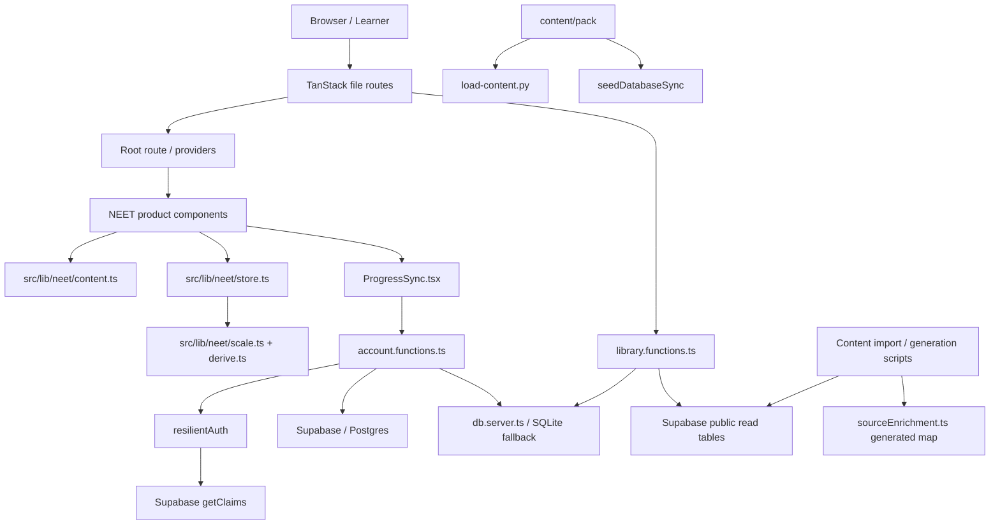

# System-Design — Repository Audit, Product Strategy, PRD and Delivery Roadmap

**Audit date:** 25 November 2026  
**Source:** `System-Design.zip` (snapshot extracted as `System-Design-main`)  
**Scope:** source-code structure, application behavior, persistence/authentication paths, content/research pack, test inventory, current technical documentation, domain research, product requirements and recommended sequencing.  
**Status:** analysis and planning only. No repository files, database schema, generated source, or Lovable project were modified.

### Review method (Superpowers-style workflow)

The review followed a staged code-understanding and planning sequence: (1) read repository guardrails before touching implementation; (2) inventory the complete code and data layout; (3) trace the route → component → state/domain function → server function → persistence path; (4) inspect the account, progress and content pipelines at their source line ranges; (5) validate source-pack counts, duplicate roots, internal links and audit-status coverage programmatically; (6) compare implementation behavior with current Context7 documentation and independent domain research; and (7) convert findings into severity-ranked fixes, acceptance tests, a product requirements document and dependency-ordered implementation milestones. The companion CSV supplies the file-level import/export map.

The review is intentionally static and non-destructive. It focuses semantic line-level inspection on the application-specific business logic, routes, account boundary, persistence, generated-data pipeline and content model. Generic UI primitives and generated artifacts are inventoried and their ownership/boundaries are recorded, rather than being individually rewritten or treated as product-specific logic.

---

## 1. Executive assessment

The project is not merely a systems-design reading site. It is an early-stage **self-directed systems thinking, system design and systems engineering learning environment**. It combines:

- A curated learning curriculum with paths, modules, lessons, prerequisites and practical labs.
- A searchable knowledge pack, reference register, practice prompts, role/competency matrix and research-coverage records.
- A four-stage progression model: **Search → Know → Adapt → Proceed**.
- A skill graph and a weighted evidence model intended to represent increasing levels of capability.
- Accounts, learning goals and progress-event syncing.

The product direction is credible. The strongest idea is the move from passive content consumption toward evidence-based practice. The weakest part is that the implementation currently does not fully realise that idea: detailed skill evidence and mastery calculations remain browser-local, while the cloud account stores only coarse activity events. At the same time, the account fallback middleware does not fail closed when authentication is missing or invalid. That is a release-blocking concern if these account functions are exposed in a deployed environment.

### Overall assessment

| Area | Assessment | Main reason |
|---|---|---|
| Product concept | Strong foundation | The north star is about engineering judgment; the app already combines learning, practice, skills and references. |
| Curriculum model | Promising but under-specified | 11 paths, 19 modules, 26 lessons and 10 labs exist, but competency-to-assessment traceability is incomplete. |
| Evidence/mastery model | Useful prototype | Explainable weighting, decay and level gates exist, but evidence is local and self-reported rather than independently assessed. |
| Authentication | Release-blocking risk | `resilientAuth` trusts an unverified JWT subject for local fallback and accepts a fixed fallback user ID. |
| Progress persistence | High-risk inconsistency | Client evidence and score state do not sync to the account; the retry queue and backfill have account-switch/reload hazards. |
| Knowledge provenance | Strong base, misleading labels | 320 source records exist, but 80 lack exact source-ID citations and are associated heuristically; UI presents all as cited. |
| Data architecture | Too many fallback paths | Supabase/Postgres and local SQLite are both used for account/content paths, with dual writes and divergent failure behavior. |
| Testing | Insufficient for security-critical behavior | Existing tests cover SQLite, progress math and one routing case; no auth middleware, account isolation, sync or end-to-end tests. |
| Production readiness | Not established | This archive alone cannot verify the live Lovable/Supabase environment; dependencies are not installed and tests cannot be run here. |

### Recommended strategic decision

**Keep the current stack. Do not rewrite the application or migrate frameworks.** Retain React, TypeScript, TanStack Start/Router, Supabase/Postgres and the Lovable workflow. First make authentication and persistence trustworthy. Then turn the existing skills and labs into a versioned competency-and-evidence model. Finally, grow the product around scenario-based assessment, portfolio artifacts and transparent knowledge provenance.

The next stage should therefore be **security and learning-data integrity**, not more lesson volume, visual redesign, AI features or another large research expansion.

---

## 2. What the product is trying to become

The project north-star file, `.lovable/north-star/north-star.md`, states:

> Learners gain the judgment to design and engineer real-world systems well.

That is a much stronger promise than “complete lessons about system design.” It implies the platform should help a learner:

1. Frame an ambiguous problem and identify the system boundary.
2. Understand stakeholders, context, constraints, mission and lifecycle.
3. Convert needs into measurable, verifiable requirements.
4. Construct and compare candidate architectures.
5. Reason about interfaces, behavior, data, dependencies and trade-offs.
6. Analyze reliability, safety, security, uncertainty and operational behavior.
7. Plan integration, verification, validation, transition and lifecycle support.
8. Defend decisions with evidence and explain what could invalidate them.

The current metric in the north-star file is **“Lessons completed each week.”** That is not a good proxy for engineering judgment. It rewards consumption, not the ability to reason or produce sound engineering work. Keep it as a funnel/engagement metric, but do not use it as the north-star outcome.

### Proposed product north star

**Percentage of monthly active learners who demonstrate an improvement of at least one rubric-defined competency level on a fresh assessment or artifact within a rolling 28-day period.**

Supporting measures:

- Weekly active learners submitting qualifying evidence.
- Percentage of required competencies with at least one current evidence item.
- Improvement on variant/scenario assessments, not merely repeated identical quizzes.
- Percentage of lab artifacts that meet the stated rubric threshold.
- Evidence retention after a spaced re-assessment window.
- Learner return rate after receiving actionable feedback.

The exact thresholds must be calibrated with real learner data. They should not be selected because they make a dashboard look good.

---

## 3. Repository architecture and structure

### 3.1 Repository shape

The audited archive contains **137 TypeScript/TSX/JavaScript/Python/SQL code files totalling 31,276 lines** in `src/`, `scripts/` and `drizzle/`. This includes 46 shared UI primitives and generated files. The companion CSV inventory lists every included file, line count, import strings and exported top-level declarations.

| Location | Responsibility | Important contents |
|---|---|---|
| `src/routes/` | File-based route layer | Public pages, protected learner pages, route loaders and page composition. |
| `src/components/neet/` | Product-specific UI | Dashboard, learning path/lesson UI, labs, skill maps, calibration, learner profile and progress sync. |
| `src/components/ui/` | Shared UI primitives | Radix/shadcn-style wrappers and reusable controls; 46 files. |
| `src/lib/neet/` | Core product/domain logic | Curriculum model, types, local state, mastery math, auth/account functions, content APIs and SQLite implementation. |
| `src/hooks/` | React hooks | Session and current-user queries, mobile behavior. |
| `src/integrations/supabase/` | Supabase integration | Client, server client, auth helpers, generated database types and preview auth storage. |
| `scripts/` | Content/build data pipeline | Markdown parsing, database loading, SQLite seeding and source-enrichment generation. |
| `content/pack/` | Canonical research pack per `AGENTS.md` | 120 Markdown files and CSV/JSON registries/coverage/audit records. |
| `SS_content/` | Duplicate research pack copy | Currently byte-identical to `content/pack/`, but referenced by the source-enrichment generator. |
| `drizzle/` | Schema/migrations | Postgres schema and SQL migration history. Lovable instruction says not to edit directly. |
| `.lovable/` | Product/deployment context | North star and Lovable-specific project files. |
| `src/start.ts`, `src/router.tsx`, `src/server.ts`, `vite.config.ts` | Application infrastructure | TanStack Start middleware, router, server bootstrap and Vite configuration. |

### 3.2 Runtime dependency map

### 3.3 How a learner request moves through the application

**Initial request / page render**

- `src/start.ts` registers `attachAuth`, error middleware, security headers and CSRF middleware.
- `src/router.tsx` creates the TanStack router and React Query client.
- `src/routes/__root.tsx` provides the root shell, route outlet, navigation, footer, command palette, toast system and global `ProgressSync` component.
- Route files load static curriculum data directly or call server functions for database-backed library/reference material.

**Learning path and lesson flow**

- `/paths/` reads `PATHS` and `DISCIPLINES` from `src/lib/neet/content.ts` and renders `PathCard` and `SkillMap`.
- `/paths/$slug` finds a path, flattens modules/lessons, calculates progress and renders `RoadmapAccordion` and `StartButton`.
- `/_authenticated/learn/$path/$lesson` resolves the path/lesson, checks route access, and renders lesson content, sidebar, actions, prerequisite/skill information and reflection/pause components.
- `store.ts` records completion, saved lessons, quiz answers, explain-back and lab evidence in browser localStorage.
- `scale.ts` derives per-skill confidence/mastery and `nextBestStep`; `Dashboard.tsx`, `SkillMap`, `SkillRadar`, `StageRing` and `CalibrationView` present those derived values.

**Reference library flow**

- `/library/` calls `listArticles()` and `searchArticles()`.
- `/library/$slug` calls `getArticle()` and renders Markdown, previous/next navigation and source cards.
- `/sources`, `/exercises`, `/careers` and `/coverage` call the corresponding functions in `library.functions.ts`.
- `library.functions.ts` reads Supabase tables using the public key and falls back to local SQLite.
- The source cards are augmented by the generated `sourceEnrichment.ts` map.

**Account and progress flow**

- `auth-client.ts` selects Supabase Auth when configured; otherwise, it falls back to a local browser account implementation.
- `auth-attacher.ts` attaches the browser session token to server-function calls.
- `account.functions.ts` applies `resilientAuth`, then reads/writes profile, goal and event records in Supabase or local SQLite.
- `ProgressSync.tsx` listens for `neet:progress`, batches activity events and calls `recordEvents()`.
- `use-me.ts` and `use-session.ts` hydrate the account view and profile state.

### 3.4 Route map

| Route | Main purpose | Main implementation/dependencies | Auth intent in code |
|---|---|---|---|
| `/` | Product landing | `index.tsx`, `PathCard`, `PATHS`, `LABS`, `STAGES` | Public |
| `/auth` | Sign in / sign up | `auth.tsx`, `auth-client.ts` | Public |
| `/reset-password` | Password reset | `reset-password.tsx`, `auth-client.ts` | Public |
| `/paths/` | Learning path discovery | `paths.index.tsx`, `PathCard`, `SkillMap`, `PATHS` | Public |
| `/paths/$slug` | Path and module view | `paths.$slug.tsx`, `RoadmapAccordion`, `StartButton`, progress store | Public route in route tree |
| `/_authenticated/learn/$path/$lesson` | Lesson and learning activities | lesson route, `LessonBlocks`, `LessonSidebar`, `LessonActions`, `SignatureGate` | Protected layout; client-side check currently |
| `/labs` | Practical tasks | `labs.tsx`, `LABS`, `LabCard` | Public |
| `/library/` | Knowledge index/search | `library.index.tsx`, `listArticles`, `searchArticles` | Public |
| `/library/$slug` | Knowledge article and sources | `library.$slug.tsx`, `getArticle`, Markdown/source cards | Public |
| `/sources` | Research source register | `sources.tsx`, `listSources` | Public |
| `/exercises` | Practice prompt index | `exercises.tsx`, `listPrompts` | Public |
| `/careers` | Role/competency matrix | `careers.tsx`, `listRoles` | Public |
| `/coverage` | Research coverage and gaps | `coverage.tsx`, `getCoverage` | Public |
| `/method` | Explains progression method | `method.tsx`, `STAGES` | Public |
| `/health` | Runtime/data health page | `health.tsx`, `getHealth` | Public — should be split into public liveness and authenticated diagnostics |
| `/_authenticated/me/` | Learner dashboard/profile | `me.index.tsx`, `Dashboard`, `ProgressHeatmap`, `useMe`, `exportDossier` | Protected layout; client-side check currently |
| `/_authenticated/me/calibration` | Confidence calibration | `me.calibration.tsx`, `CalibrationView` | Protected layout; client-side check currently |

### 3.5 Core domain model

`src/lib/neet/types.ts` defines the application-level shapes for discipline, stage, evidence type, skill, evidence, level/progress, content block, lesson, module, path, lab and learning repository.

`src/lib/neet/content.ts` is the static curriculum catalogue:

- `SITE`: app identity and copy.
- `STAGES`: Search, Know, Adapt and Proceed.
- `DISCIPLINES`: Systems Thinking, System Design and Engineering.
- `SKILLS`: 16 skills with prerequisite references.
- `PATHS`: 11 top-level paths, 19 modules and 26 lesson entries.
- `LABS`: 10 practical lab definitions.
- Helpers: `lessonKey`, `lessonHref`, `flatLessons`, `allLessons`, `pathMinutes`, `skillById`.

`src/lib/neet/derive.ts` contains derived curriculum/progress helpers; `scale.ts` calculates skill scores and next-best steps; `progress-math.ts` covers heatmap/streak/discipline mapping; `store.ts` owns the browser progress state.

### 3.6 Database and content model

**Postgres / Supabase tables from migrations**

- Public read-only content tables: `articles`, `sources`, `practice_prompts`, `roles`, `coverage_deep`, `coverage_research`, `scrape_audit`, `pack_meta`. RLS enabled, `SELECT` granted to `anon`/`authenticated`, `ALL` granted to `service_role`.
- Per-user data tables: `profiles`, `learning_goals`, `progress_events`.
- `profiles` has owner-only read/insert/update policies.
- `learning_goals` and `progress_events` have owner-only policies using `auth.uid() = user_id`.
- `progress_events` is unique on `(user_id, kind, ref)` and has an index on `(user_id, occurred_on)`.

**Local SQLite**

`src/lib/neet/db.server.ts` contains a synchronous `node:sqlite` implementation used for local fallback/content seeding and account fallback. It seeds from `content/pack`, maintains a full-text search table and provides profile/goal/progress helper methods.

**Important implementation distinction**

The database schema and data tables support user accounts and event logs, but they do not yet store the actual evidence used by the browser mastery model. The cloud progress-event table stores `kind`, `ref`, `discipline` and `occurred_on`, not a complete evidence object, rubric score, confidence, artifact or feedback record.

---

## 4. Detailed implementation review: critical files and their responsibilities

The line references below are to the supplied archive. They are intended as stable review anchors; line numbers will shift if files change.

| File | Key line ranges / symbols | What it does | Finding / recommendation |
|---|---|---|---|
| `src/start.ts` | 21–40 | Request error/security/CSRF middleware and global auth attacher | Keep CSRF protection; extend security headers with an intentional CSP/HSTS strategy after checking deployment proxy behavior. |
| `src/routes/__root.tsx` | 75–153 | Root metadata, shell, providers, global layout and `ProgressSync` | Root route centralizes global sync; auth-state change invalidates router/query state. Ensure all user-sensitive query caches are cleared on sign-out/account switch. |
| `src/routes/_authenticated/route.tsx` | 4–12 | Authenticated route layout | `ssr: false` plus client-side `authClient.getUser()` is a navigation guard, not authorization. Every server function must independently reject unverified requests. |
| `src/integrations/supabase/auth-middleware.ts` | 34–103 | Generated `requireSupabaseAuth` middleware; requires config, bearer token and verified claims | This is materially safer than `resilientAuth`, but appears unused by the account functions. It is generated; do not hand-edit. Adopt/replace via the supported Lovable workflow. |
| `src/lib/neet/auth-client.ts` | 7–18, 24–32, 52–60, 134–153, 171–254 | Supabase auth wrapper and local mock-auth fallback | Local account record includes raw password in localStorage; local token uses `alg: none`. Restrict this entire path to explicit development mode. |
| `src/lib/neet/account.functions.ts` | 27–99 | `AccountAuthContext` and `resilientAuth` | Release-blocking: decodes unverified `sub` before validation and uses a default user ID if no verified claims are available. Must fail closed. |
| `src/lib/neet/account.functions.ts` | 101–145 | `getMe` | Reads account profile, goals and events; RLS provides owner scope in Supabase. Fallback to local SQLite on any Supabase query failure can make persisted account view differ from the cloud state. |
| `src/lib/neet/account.functions.ts` | 147–257 | `signCommitment`, `addGoal`, `removeGoal` | Zod input validation is present. Successful Supabase writes are mirrored into local SQLite; errors also fall back locally. This creates dual-write divergence and needs a single production source of truth. |
| `src/lib/neet/account.functions.ts` | 259–295 | `eventSchema`, `recordEvents` | Event schema restricts kind/ref/discipline/date shape and upserts idempotently. It stores activity only, not the rich evidence data used by mastery. Date regex should also validate an actual calendar date. |
| `src/lib/neet/account.functions.ts` | 297–303 | `exportDossier` | Exports from local SQLite even if the cloud account is the real source of truth; can return stale/incomplete data. |
| `src/lib/neet/store.ts` | 5–50 | Browser state type, key, lazy read/write and listener store | One global key `neet.progress.v1` is not scoped to the active account. Use an explicit account namespace or server-first state. |
| `src/lib/neet/store.ts` | 81–103 | Progress signals and snapshot helpers | Activity event is separate from evidence details. Keep event IDs and event timestamps deterministic/idempotent for sync. |
| `src/lib/neet/store.ts` | 108–173 | Lesson, quiz, explain-back and lab evidence actions | Quiz/evidence/reflection/lab values remain local. Lab rating is self-reported; there is no rubric reviewer or accepted-artifact state. |
| `src/components/neet/ProgressSync.tsx` | 24–91 | Browser-to-account progress forwarder/backfill | Queue is only in memory, survives account-effect cleanup, backfill flag is set before acknowledgement, and old completed lessons are assigned today. Rebuild around durable, user-scoped, idempotent sync. |
| `src/lib/neet/scale.ts` | 4–16, 17–61, 64–94, 103+ | Evidence decay, weighted skill calculation, levels/calibration and next step | Formula is explainable but weights/half-life/thresholds are unvalidated product parameters. Label score as provisional until evidence is persisted and validated. Version formula parameters. |
| `src/components/neet/LabCard.tsx` | Entire component; calls `actions.submitLab` | Learner enters note and self-rating | Good prototype interaction, but an artifact link or note is not verified evidence. Add structured deliverables and rubric-based review. |
| `src/components/neet/Dashboard.tsx` | Entire component | Dashboard from locally-derived scores/skill data and path information | The dashboard can imply an account-level mastery picture even though the score data is local. Make source and sync state explicit. |
| `src/lib/neet/library.functions.ts` | 33–75 | Public content client and article list | Public read-only content access is appropriate. The local SQLite fallback should be development-only or clearly treated as a degraded, non-authoritative cache. |
| `src/lib/neet/library.functions.ts` | 77–104 | Search articles | Query string is truncated and some PostgREST punctuation is sanitized. Consider a server-side search RPC/FTS query with robust escaping and a strict result cap. |
| `src/lib/neet/library.functions.ts` | 106–159 | `getArticle` and adjacency/navigation | Each article request fetches the full nav and filename map. This is O(number of articles) transfer on every detail request; cache or return a compact precomputed index. |
| `src/lib/neet/library.functions.ts` | 161–201 | `listSources` and enrichment mapping | Joins DB records to generated enrichment; relationship semantics currently mix direct citation and inferred related reading. |
| `src/lib/neet/library.functions.ts` | 203–271 | Prompt/role/coverage reads | Straightforward read APIs, but no shared resource/competency graph yet. |
| `src/lib/neet/library.functions.ts` | 273–276 | `getHealth` | Returns local SQLite health data, not the actual Supabase production health. Public `/health` is misleading as a production readiness check. |
| `src/lib/neet/db.server.ts` | 451–505 | Synchronous content seeding from `content/pack` | Seeds all `.md` files, including `CONTENT_IMPORT_GUIDE.md` unless separately excluded. Decide whether import guide should be user-facing. Keep this fallback local/dev. |
| `src/lib/neet/db.server.ts` | 1011–1057 | `getSystemHealth` | Counts local tables and reports Node/platform/memory/absolute DB path and user counts. Do not expose this diagnostics surface publicly. |
| `scripts/generate_source_enrichment.js` | 41–60 | Reads source/audit/Markdown from `SS_content` and builds generated map | `AGENTS.md` says `content/pack` is canonical. Current copies are identical, but this is a split-source-of-truth and drift risk. Update generator to use canonical `content/pack` or validate identical hashes. |
| `scripts/generate_source_enrichment.js` | 275–315 | Exact ID matching then topic-based fallback mapping | Fallback associations are not citations. Store relationship type and basis, rather than calling every mapping `cited_in_articles`. |
| `scripts/generate_source_enrichment.js` | 317–332 | Generated summaries and takeaways | Generic `Authoritative reference` and `normative baseline` text is too strong for primary educational/community material. Model source authority, type and extraction state separately. |
| `src/lib/neet/sourceEnrichment.ts` | 14,290 lines; `getSourcesForArticle` at 14266–14289 | Generated enriched-source data, aliases and reverse mappings | Generated artifact; update generator and input data, not this generated file directly. Measure bundle placement before optimization. |
| `src/routes/library.$slug.tsx` | 83–94 | Displays source list under “Cited sources in this volume” | Currently overstates heuristic associations as citations. Show “Explicit citations” and “Related references” separately. |
| `src/routes/sources.tsx` | 255–273 | Shows `Cited in N volumes` backlinks | Must use explicit citation relationship only. |
| `src/routes/health.tsx` | 76–127 | Displays pack counts and runtime environment | Publicly reveals platform, Node version, DB path, memory, account row counts; labels all source records “verified”. Restrict diagnostics and correct labels. |
| `src/routes/_authenticated/me.index.tsx` | Route loader/component | Learner dashboard, heatmap and dossier export | Review for account cache invalidation and mismatch between cloud event activity and local evidence score. |
| `drizzle/migrations/0000_migration.sql` | Whole file | Public read RLS on knowledge pack | Reasonable model for anonymous read access; service-role importer is privileged and must be protected. |
| `drizzle/migrations/0001_accounts_progress.sql` | Whole file | Owner-only account data, goals cap and progress-event policies | User-owned row policies are a good base. Extend via Lovable-managed schema changes for evidence/artifacts/rubrics when required. |

---

## 5. Prioritized technical findings

### P0 — Release blocker: account functions do not fail closed

**Affected code:** `src/lib/neet/account.functions.ts:32–99`; `src/lib/neet/auth-client.ts:7–18, 52–60, 134–153, 171–254`; `src/integrations/supabase/auth-middleware.ts:34–103`; `src/routes/_authenticated/route.tsx:4–12`.

`resilientAuth` decodes the JWT payload and copies `sub` into `tokenUserId` before signature/claim verification. If there is no token, missing Supabase configuration, or a `getClaims()` failure, the middleware still continues using `tokenUserId` or a fixed UUID. Its log message explicitly describes fallback to a local user. Account operations then access local SQLite using that identifier. The browser fallback also stores password strings in localStorage and issues an unsigned `alg: none` token.

The generated `requireSupabaseAuth` helper already follows the correct core pattern: require configuration, require a bearer token, call `getClaims`, and reject absent/invalid claims. But account functions use `resilientAuth` instead.

**Impact:** unauthenticated or forged-token requests may reach the local account fallback. With a forged JWT payload, the subject can be chosen without cryptographic proof. With no token, calls use the same default account ID. Whether this is exploitable against a specific hosted environment depends on its runtime configuration and whether local SQLite persists, which cannot be established from the archive; the code path itself is unsafe and should not be deployed.

**Required correction:**

1. Replace permissive fallback identity with a single fail-closed verified-principal function.
2. Do not read `sub` from an unverified token for any authorization decision.
3. Missing auth, missing production Supabase configuration, malformed token, expired token or failed `getClaims()` must reject the request.
4. Remove the fixed default user ID.
5. Gate local mock auth/SQLite account behavior behind an explicit development-only switch. Production must not accept local tokens.
6. Keep passwords out of browser persistence. Use Supabase Auth for accounts; do not attempt to improve the local mock by merely hashing a password client-side.
7. Ensure all account server functions use the same verified middleware.
8. Preserve RLS as the second authorization boundary; server middleware does not replace RLS.

**Acceptance tests:** no token → 401; malformed token → 401; `alg:none` token → 401; tampered/expired token → 401; valid user A cannot read/write user B's profile/goals/events; missing production Supabase configuration → fail closed; local auth is unavailable in production builds; no default account is created or used.

### P1 — High: browser mastery state and cloud progress state are different systems

**Affected code:** `store.ts:5–50, 81–103, 108–173`; `ProgressSync.tsx:24–91`; `account.functions.ts:259–295`; `scale.ts`.

The local store contains completed lessons, saved resources, quiz choice/confidence, scored quiz evidence, explain-back text/rating and lab note/rating/time. The server progress event stores only event kind/ref/discipline/date. Consequently, the cloud does not contain the full evidence the `scale.ts` formula uses to derive skill mastery.

ProgressSync adds four reliability issues:

- The queue lives only in a React ref; reload loses queued events.
- The backfill flag is persisted before the server acknowledges the backfill; a failure/reload can permanently skip unsynced records.
- Effect cleanup clears the timer but does not clear or namespace the queue; an account switch can expose a race in which old-user activity is flushed under a new user's server identity.
- Backfill assigns every previously completed lesson to the current date rather than the original completion date.

Additionally, browser progress uses one global `neet.progress.v1` key for every signed-in account. The same device can blend learning history across account changes.

**Required correction:**

- Store a durable local outbox of event/evidence records with event UUID/idempotency key, `user_id` namespace, created/occurred timestamps, schema version, retry count and sync state.
- On account change, pause the outbox, flush only under the original verified user or quarantine it; never rebind an old user's pending records to a new user.
- Mark backfill complete only after acknowledgement and persist successful cursor/state.
- Preserve real timestamps, including original completion dates.
- Persist the actual evidence objects and artifacts server-side; calculate account-level mastery from the canonical server evidence set.
- Ensure server rows are owner-scoped with RLS and the event/evidence APIs validate each resource reference.

**Acceptance tests:** browser reload with pending queue; offline/online transition; duplicate event; session expiry; logout/login as a different account; failed backfill; simultaneous tabs; cross-device state; no event is attributed to a different account; historical timestamps remain historical.

### P1 — High: current competency score is not independently demonstrated mastery

**Affected code:** `scale.ts:4–16, 17–61, 64–94`; `store.ts:119–173`; `LabCard.tsx`.

The formula is explainable: 45-day half-life, weighted quality, evidence coverage target of 6, and level gates for variant/lab/artifact. That is a good product prototype. However, the parameters are not empirically calibrated, and the current `LabCard` accepts a learner-selected rating. A self-rating of “Solid” should not be presented as proof that a learner can design or engineer a system independently.

**Required correction:**

- Retain the explainable model, but mark current scores as provisional/self-reported until a structured assessment exists.
- Define observable performance descriptors per competency level and task complexity.
- Separate evidence types: self-reflection, quiz, variant task, lab artifact, peer review, instructor review, automated check.
- Separate **evidence coverage**, **assessment confidence**, **recency** and **level attainment** in the UI.
- Version the formula and store the model version used to calculate each snapshot.
- Validate the 45-day decay, weight choices and thresholds using real assessment outcomes before changing learner progression automatically.

### P1 — High: source relationships are overstated as citations

**Affected code:** `scripts/generate_source_enrichment.js:275–315, 317–332`; `sourceEnrichment.ts:14266–14289`; `library.$slug.tsx:83–94`; `sources.tsx:255–273`.

The source register contains 320 distinct IDs/URLs. Exact source IDs appear in 240 of them in the Markdown corpus; the remaining 80 have no exact ID string in an article. The generator associates those records to topic volumes using heuristic topic-to-volume mapping, then places them in the same `cited_in_articles` map as explicit citations. The UI says “Cited sources in this volume” and “Cited in N volumes”.

The generator also uses broad conditions (`qualitySignal.includes("primary")` or `includes("Official")`) to label sources as “normative baseline”. A primary educational reference or community source is not automatically a normative standard.

**Required correction:**

- Introduce relationship types: `explicit_citation`, `related_reading`, `topic_candidate`, `source_anchor`.
- Store relationship basis, confidence and reviewer status.
- Only explicit article-body source IDs or validated citation links should render as citations.
- Separate source authority from source category and extraction completeness.
- Use “normative” only for an identifiable applicable standard/regulatory requirement, and only with current edition/status and jurisdiction context.
- Display `last_checked`, `edition/status`, `extraction_status`, `limitations`, `access/licensing`, and `review_due_at`.

### P1 — High: split content roots create drift risk

**Affected files:** `AGENTS.md`; `scripts/generate_source_enrichment.js:41–50`; `src/lib/neet/db.server.ts:451–505`.

`AGENTS.md` says `content/pack` is canonical. The SQLite loader reads `content/pack`, but the source-enrichment generator reads `SS_content`. The 128 common files across both folders are currently byte-identical, so no present discrepancy was found. However, two input roots are still a maintenance hazard.

**Required correction:** use `content/pack` as the single canonical path for import and generation, or create one generated alias with a checksum validation. Do not delete the legacy folder until the Lovable/repo workflow no longer references it. Add a CI assertion that the generated source map is reproducible from the canonical pack.

### P2 — Medium: `/health` exposes internals and does not measure hosted DB health

**Affected files:** `library.functions.ts:273–276`; `db.server.ts:1011–1057`; `routes/health.tsx:76–127`.

The public health route returns local SQLite counts and runtime information, including Node version, platform, database file path, memory usage and user row counts. It calls `getSystemHealth()` on local SQLite even though the hosted product's primary content/account persistence is Supabase. The UI calls all 320 source records “verified”, although the source audit includes discovery-only, blocked, partial and unreachable statuses.

**Required correction:**

- Public `/healthz`: return only `ok`/version/build ID and no user or runtime internals.
- Protected `/admin/diagnostics`: authenticated role, redact filesystem paths, row-level personal counts and resource details.
- `/readyz`: perform bounded readiness checks against the configured production data store and critical services.
- Replace “verified sources” with exact source status counts: registered, extracted, partially extracted, discovery-only, blocked/unreachable and stale.

### P2 — Medium: local SQLite fallback can hide production outages and produce divergent user state

**Affected files:** `account.functions.ts:101–145, 161–257, 266–303`; `library.functions.ts`; `db.server.ts`.

The account functions fall back to SQLite after Supabase errors and often dual-write to SQLite after successful Supabase operations. This creates two sources of truth. Local SQLite can be useful in tests and local development, but an outage in production should not silently return stale state and imply success.

**Required correction:** keep SQLite as a local development/test adapter only. Production account data should have one canonical persistence provider. If Supabase is unavailable, return an explicit degraded error and preserve the client outbox for retry rather than silently switching account stores.

### P2 — Medium: learner-data export is tied to SQLite

**Affected file:** `account.functions.ts:297–303`.

`exportDossier()` always calls `localDb.exportLearnerDossier()` and ignores the Supabase client. Once cloud storage is authoritative, exports can omit recently synced account records and evidence.

**Required correction:** build the export from the canonical server-side user evidence/profile tables, under verified identity and owner scoping. Include a visible export timestamp and data coverage statement.

### P2 — Medium: article detail fetch transfers the full navigation map

**Affected file:** `library.functions.ts:106–159`.

On every article view, `getArticle()` fetches the entire article navigation index and all slug/filename pairs. This is not a correctness issue at current scale, but it creates repeated unnecessary database transfer and response payload.

**Required correction:** cache a compact navigation/filename manifest, or store ordered article IDs in the article loader context. Measure before optimizing; current pack size is manageable.

### P2 — Medium: import guide may appear as learner content

**Affected file:** `db.server.ts:474–488`.

The SQLite seeder includes every `.md` file in `content/pack`. The 120 Markdown files include `CONTENT_IMPORT_GUIDE.md`. Check whether the import guide is meant to be a public knowledge article. If not, exclude it consistently in both import pipelines and the article count metadata.

---

## 6. Content and research-pack audit

### 6.1 Structural QA results

| Asset | Count | Audit result |
|---|---:|---|
| Markdown knowledge files | 120 | Present in `content/pack`; approx. 101,168 words across these files. |
| Structured source records | 320 | 320 distinct source IDs and 320 distinct non-empty URLs. |
| Practice prompts | 73 | Structured exercise prompts with concept/artifact fields. |
| Career-role records | 28 | Role, career level, competency areas, deliverables, source anchors and portfolio project fields. |
| Deep-coverage domains | 50 | Includes evidence status, residual gaps and validation actions. |
| Research-coverage domains | 28 | Includes file/source anchors and known limitations. |
| Scrape-audit rows | 162 | Distinguishes full, partial, targeted, discovery-only and inaccessible sources. |
| Internal relative Markdown links | 0 broken | Static path validation found no broken local Markdown links. |
| Duplicate content files | 128 / 128 identical | All shared filenames between `SS_content/` and `content/pack/` were byte-identical. |

The scrape audit is **not** proof that all 320 sources were fully read. The 162 audit rows have mixed states; among them are 48 labelled `Full fetch`, 12 `Full extraction`, 8 `Targeted extraction`, 36 `Discovery only`, and other partial/blocked/unreachable states. The UI must preserve those distinctions.

### 6.2 Content quality and limitations

The pack is unusually broad and includes systems science, systems engineering, software/enterprise architecture, reliability, assurance, safety, security, human systems, cyber-physical systems, operations research, lifecycle support, sustainability and specialist exercises.

The metadata itself is appropriately cautious: it says the pack is an expanded research foundation, not globally exhaustive; does not claim credential endorsement or regulatory approval; says standards may be paywalled/licensed; and explicitly warns that exercises are prompts rather than formally verified, independently graded or certified work.

However, the metadata also contains historical count notes from earlier research passes. The latest top-level fields should be treated as the current snapshot (`as_of: 2026-11-05`, `source_count: 320`, `markdown_knowledge_files: 120`, `scrape_audit_rows: 162`), and old counts inside the notes should not be interpreted as conflicting current totals.

### 6.3 Content pipeline recommendation

Use a reproducible import pipeline with these gates:

1. **Schema validation:** headers, required fields, unique keys, valid URLs, valid dates/enums and foreign keys.
2. **Citation validation:** every `Sxxx` ID referenced by Markdown exists in `sources.csv`; every source-to-article relationship carries an explicit relationship type.
3. **Freshness validation:** standards, regulatory guidance and software tools have issuer/date/status fields and review dates.
4. **Extraction-state validation:** content quality claims derive from audit state; discovery-only does not become “full text reviewed”.
5. **Content validation:** title, heading, slug, word count, broken internal links and accidental import/administrative docs.
6. **Deterministic generation:** generate source map and database import from one canonical content root; fail CI if the checked-in generated output differs.
7. **Safe publishing:** import to a staging dataset or temporary tables, verify counts and references, then publish with a transaction/atomic swap strategy where supported.

`load-content.py` uses a service-role credential for upserts and deletes/reloads certain table sets. Keep the secret out of the repository and Lovable-managed secrets; add dry-run, preflight counts, staging/backup and post-import verification before relying on it for production refreshes.

---

## 7. External domain research and product benchmarks (EFT)

Research was run in the requested order: **Exa discovery → Firecrawl extraction → TinyFish independent search/fetch**. The important result is not a need for more content volume. It is the need to connect the existing knowledge base to observable engineering competencies and realistic assessments.

### 7.1 Competency framework

The [INCOSE Systems Engineering Competency Framework (2nd Edition)](https://incose.org/resources-publications/publish-with-incose/competency-framework/) describes 37 competencies and explicitly positions the framework as tailorable to a specific application, project, organization or enterprise. It is a suitable external reference for curriculum mapping, but the app should not merely clone the framework: tailor it to the project's learner audience and distinguish general competence from domain-specific expertise.

[SEBoK — Roles and Competencies](https://sebokwiki.org/wiki/Roles_and_Competencies) ties competency to knowledge, skills, abilities and attitudes, and describes systems thinking, holistic lifecycle view and technical/management methods as recurring competency themes. It also explains that Bloom-style cognitive outcomes span remembering, understanding, applying, analyzing, evaluating and creating. This supports a progression design where a learner moves beyond recall into scenario analysis, solution evaluation and artifact creation.

[SEBoK — Assessing Individuals](https://sebokwiki.org/draft/Assessing_Individuals) distinguishes individual competency from performance in a particular team/context. Its competency assessment discussion includes observable proficiency levels, but warns that proficiency must be assessed in context and that a competent individual is not automatically guaranteed to perform well in every system/team. This argues against issuing broad “expert” labels from a few quiz answers.

### 7.2 Systems engineering lifecycle and traceability

[SEBoK — Stakeholder Needs Definition](https://sebokwiki.org/wiki/Stakeholder_Needs_Definition) and [SEBoK — System Requirements Definition](https://sebokwiki.org/wiki/System_Requirements_Definition) describe the chain from mission/context and stakeholder needs to technical system requirements, architecture/design inputs, integration and verification. The requirements article emphasizes planning verification success criteria early so the requirement is verifiable.

Product implication: connect every major lesson/exercise to an outcome and connect each outcome to an observable artifact. A learner should be able to trace:

`stakeholder need → requirement → architecture element/interface → risk/control → verification method → validation evidence`.

The [NASA Systems Engineering Handbook](https://www.nasa.gov/reference/system-engineering-handbook/) and the [INCOSE Systems Engineering Handbook](https://www.incose.org/resources-publications/technical-publications/se-handbook/) are authoritative companion references for lifecycle methods and engineering practice. Their full normative/handbook text should not be reproduced without appropriate rights; link, summarize within the permitted scope and retain source edition/status.

### 7.3 Learning design: scenarios, feedback, projects and mastery

Research discovered through Exa includes:

- [ASEE — Systems Engineering Experience Accelerator](https://doi.org/10.18260/1-2--18193): experiential simulation, performance feedback, reflection and development goals. The value is the loop from decision → consequence → feedback → reflection → next practice, not just simulated content.
- [ASEE — Development of a Systems Engineering Course for Multiple Delivery Methods](https://doi.org/10.18260/1-2--20311): scenario-based teaching centered on a realistic rail system project and uses decision tasks, examples and feedback to practise judgment in context.
- [ASEE — Leveraging Active Learning Techniques to Teach Model-Based Systems Engineering](https://peer.asee.org/leveraging-active-learning-techniques-to-teach-model-based-systems-engineering.pdf): progressive modeling assignments move learners from needs/requirements through functional/logical design to analysis and verification, with criteria and feedback.
- [ASU — Mastery or Competency Learning](https://lth.engineering.asu.edu/reference-guide/mastery-or-competency-learning/): emphasizes repeated opportunities, fast actionable feedback and enrichment/alternative assessments. Useful for prerequisite foundations; it is not a reason to force every creative design task into a single threshold quiz.
- [Frontiers in Education (2026) — Project-based learning with digital technologies and competency development](https://www.frontiersin.org/journals/education/articles/10.3389/feduc.2026.1847905/full): a quasi-experimental study of 240 Education Science students reported small-to-moderate gains in conceptual understanding, contextual application, autonomous technology use, teamwork and self-regulation; creativity did not significantly improve. This is supportive but not direct proof for systems engineering students.

Product implication: build a repeated practice cycle: concise concept → worked example → retrieval prompt → scenario variation → artifact → rubric feedback → revise → re-assess. Reuse one continuous system case across multiple modules so learners see cross-domain coupling and lifecycle consequences.

### 7.4 AI-assisted assessment

[SmartRubrics (2025), Sustainability](https://www.mdpi.com/2071-1050/17/13/6098) explores AI-supported rubric design and competency assessment but describes a tool whose authentic deployment and impact still require validation. Treat AI as a later formative assistant: it can point out missing evidence, ask a clarifying question or map a draft to rubric criteria. Do not let it be the sole grader, evidence verifier or credential issuer.

### 7.5 What to borrow — and what not to copy

| Pattern | Recommendation | Why |
|---|---|---|
| Competency graph with prerequisites | Adopt | Skills are dependent; make prerequisite and related/extends relationships explicit. |
| Learning objectives linked to every task | Adopt | Supports traceability and measurable learning outcomes. |
| Continuous scenario/capstone | Adopt | Allows trade-offs, context and lifecycle learning to accumulate. |
| Repeat attempts with feedback | Adopt selectively | Very useful for foundational knowledge and skill practice; creative artifact work needs richer rubric feedback. |
| Portfolio of versioned artifacts | Adopt | Gives observable evidence of engineering capability. |
| Automatic mastery from content opened | Reject | It measures clicks, not competence. |
| Generic AI-generated grading | Defer/restrict | Assessment validity and bias have to be demonstrated first. |
| Broad expert/certification claims | Reject | The app is not an accredited certification authority. |

---

## 8. Proposed PRD — System-Design Learning Platform v1

### 8.1 Product summary

Build a self-directed learning platform that helps learners develop practical systems thinking, system design and systems engineering judgment through a curated curriculum, connected competency model, progressively challenging scenarios, structured labs, feedback and a defensible portfolio of evidence.

### 8.2 Problem statement

Learners can find large amounts of technical material but struggle to turn disconnected concepts into a coherent approach for framing problems, evaluating architectures, handling trade-offs and producing verifiable engineering deliverables. Traditional completion tracking does not show whether a learner can apply concepts in a different context or defend a design decision.

The current application has the right ingredients, but learner evidence is mostly local/self-reported and is not yet a reliable account-level record. Source-to-article mappings also need provenance clarity before the library can be relied on as a transparent reference environment.

### 8.3 Target users

**Primary persona — Self-directed technical learner**

A university student or early-career engineer who wants structured progression from fundamentals to applied system design and needs concrete work to show what they can do.

**Secondary persona — Practising engineer / career switcher**

A learner who has some domain experience and wants to fill gaps, review specific competencies, practise trade-offs and build a portable portfolio.

**Content maintainer / reviewer**

A trusted curator who maintains content, source provenance, competency mappings, rubrics and standards freshness. This is an operational/admin role, not a prerequisite for the first learner release.

Assumption: the initial product is self-directed and individual-first. Cohorts, enterprise administration, instructor grading workflows and certificates are not assumed to be in scope for v1.

### 8.4 Goals

1. Make competency outcomes explicit and traceable to content, exercises and artifacts.
2. Preserve learner identity, evidence and progress reliably across devices and sessions.
3. Assess application and engineering judgment, not just recall and completion.
4. Make external references transparent about authority, freshness, extraction and limitations.
5. Give the learner a useful view of strengths, gaps, confidence, next steps and a portable portfolio.
6. Keep the existing architecture maintainable and compatible with Lovable's ownership rules.

### 8.5 Non-goals

- Do not claim formal INCOSE, ISO, NASA, regulatory or university certification.
- Do not reproduce copyrighted standards or paid handbook content.
- Do not attempt to build a full enterprise LMS in the first release.
- Do not let an LLM autonomously certify or independently grade high-stakes competencies.
- Do not rebuild the app on a new framework or database without evidence that the current stack cannot meet needs.
- Do not expand the pack just to increase raw source/article counts.

### 8.6 Core learner journey

1. **Onboard:** select a target role/goal, experience level and time/effort preference; take a short diagnostic that identifies likely starting competencies.
2. **Choose a path:** learner sees required prerequisites, outcomes, time estimates and the evidence expected at the end.
3. **Learn:** short content, worked examples, concept diagrams and source references.
4. **Retrieve:** answer questions with confidence rating; get targeted explanations and optional prerequisite review.
5. **Apply:** complete a variant problem or scenario with changed constraints.
6. **Build:** submit a structured artifact (diagram, requirements set, ADR, trade study, risk analysis, test plan, model, code/prototype, etc.).
7. **Review:** receive rubric-based feedback, identify missing evidence and revise.
8. **Demonstrate:** complete a fresh assessment or artifact at the required level.
9. **Reflect:** see level, evidence coverage, confidence calibration, recency and next recommended action.
10. **Export:** generate a portfolio/dossier containing selected work, rubric results, dates, references and limitations.

### 8.7 Core functional requirements

#### FR-01 — Learner identity and isolation

- All learner/account data is bound to a verified Supabase identity.
- Every server function that reads or mutates personal data requires verified claims.
- There is no anonymous/default-user fallback in production.
- Every personal table uses RLS and ownership checks.
- Account switching clears React Query caches and isolates local pending writes.

#### FR-02 — Versioned competency catalogue

Each competency has:

- Stable ID, title, definition and discipline/domain.
- Observable performance descriptors per proficiency level.
- Prerequisites and relationships (`assumes`, `extends`, `related`).
- Role relevance and reference framework anchors.
- Learning resources and assessments linked to it.
- Version, effective date and change history.

Start with a compact v1 tailored to the current 16 skills; do not copy 37 INCOSE competencies wholesale. Map the current skill set to external frameworks where meaningful and document gaps.

#### FR-03 — Learning resource traceability

Every learning resource should declare:

- One or more learning outcomes/competencies.
- Expected Bloom/cognitive level or observable action.
- Prerequisites.
- Resource type and estimated effort.
- Evidence expected (if any).
- Source anchors and relationship type.

#### FR-04 — Assessment and evidence

- Learners can create attempts for quizzes, variants, labs, scenarios and artifact submissions.
- Every attempt has a timestamp, schema version, task/resource version, competency, score/result, feedback and owner.
- Self-reflection must be labelled separately from reviewer/automated evidence.
- Artifacts can be text, link, file/object-storage reference or structured data.
- Rubrics specify criteria, rating levels, observable descriptors and weighting.
- Attempts are repeatable; changes to prior submissions remain auditable.

#### FR-05 — Competency state

- Show level and evidence, not only one opaque score.
- Display evidence coverage, assessment confidence, freshness and outstanding prerequisites separately.
- Formula versions and weights are explainable.
- A competency cannot be labelled independently demonstrated unless the required evidence gate has been met.
- A lack of evidence is “not assessed”, not “zero ability”.

#### FR-06 — Progress sync

- Durable user-scoped outbox.
- Idempotent event/evidence ingestion.
- Safe retries and sync acknowledgements.
- No cross-user queue attribution.
- Original occurrence timestamp retained.
- Account dashboard states whether data is synced, pending or local-only.

#### FR-07 — Scenario and capstone workflow

A continuous system case should be used across learning modules. Learners build a set of related artifacts that can be revised as new skills are introduced. The first capstone should be bounded enough to assess, while still exposing cross-domain trade-offs.

#### FR-08 — Source provenance

- Display source issuer/type, date/edition/status, jurisdiction if relevant, access/licensing limitations, extraction state, last review and known limitations.
- Distinguish explicit citation from related reading/topic recommendation.
- Do not call every registry item “verified”.
- Flag stale/unknown/current status distinctly.

#### FR-09 — Portfolio and export

- Learner chooses which artifacts to share/export.
- Export contains versioned competencies, rubric results, artifact metadata, feedback and source citations.
- Export states that it is a learning portfolio, not a formal certification.
- Account owner can request/delete personal data consistent with the product's privacy policy.

### 8.8 Non-functional requirements

| Category | Requirement |
|---|---|
| Security | Verified server-side identity, fail-closed auth, least privilege, RLS, CSRF, safe output handling, secret isolation. |
| Privacy | Per-user ownership, deliberate retention policy, export/delete support, no sensitive data in logs. |
| Reliability | Durable outbox, idempotent writes, recoverable retries, database backup/restore plan. |
| Correctness | Versioned content/competency/rubric/evaluation model; reproducible import pipeline. |
| Accessibility | Keyboard usable, labelled controls, semantic headings, focus management, contrast and screen-reader checks. |
| Performance | Article navigation index cached; no unbounded user-event or article fetches; bounded server operations. |
| Maintainability | No direct edits to generated source/migrations; clear ownership between static curriculum, DB pack and app code. |
| Observability | Redacted structured logs, error reporting, latency/failure metrics, readiness/liveness separated from admin diagnostics. |
| Portability | Production uses one canonical persistence provider; SQLite local/test adapter only. |

### 8.9 Proposed data model (logical, not a migration script)

The current `profiles`, `learning_goals`, `progress_events` remain a base. The next schema iteration, authored through Lovable as required by `AGENTS.md`, should introduce entities conceptually like these:

| Entity | Purpose / key relationships |
|---|---|
| `competencies` | Versioned competency definitions, discipline, level descriptors and status. |
| `competency_relations` | Prerequisite, extends, related relationships between competencies. |
| `learning_resources` | Lessons, modules, labs, prompts, articles and scenario tasks with stable IDs/versions. |
| `resource_competencies` | Many-to-many link between resources and competencies, with relation type and expected level. |
| `rubrics` / `rubric_criteria` | Versioned assessment criteria and rating descriptors. |
| `assessment_attempts` | Learner, task/version, date, attempt number, structured outcome and reviewer state. |
| `evidence_artifacts` | User-owned artifact metadata, type, storage key/link, checksum, description and version. |
| `assessment_feedback` | Criterion-level feedback, reviewer type, timestamp and revision guidance. |
| `learner_competency_snapshots` | Derived read model with formula version, evidence coverage, confidence and level. |
| `progress_events` | Append-only idempotent activity events; retain only what is required for analytics and recovery. |
| `source_registry` | Source record with issuer, edition/status, date, limitations and extraction state. |
| `source_relationships` | Article-to-source relationship type and evidence basis. |
| `source_review_events` | Review date, reviewer, freshness decision and changed status. |

Important design decisions:

- Use stable UUIDs or deterministic slugs with a clear versioning policy.
- Store original event time and server receipt time separately.
- Use `user_id` as the owner key for all private artifacts/attempts; enforce with RLS.
- Store object content in Supabase Storage or another managed object store, not in progress rows.
- Keep competency mastery as a derived read model; the immutable source of truth is the evidence and rubric result.
- Do not store only the final scalar. Preserve criterion results and provenance so a score can be recalculated when the model changes.

### 8.10 First capstone definition

**Capstone: Design a dependable digital service under real-world constraints.**

Choose one concrete case (for example, an appointment/dispatch platform, logistics tracking service or campus access-control system). The learner must submit a connected set of artifacts:

1. Problem statement, mission success measures and system boundary.
2. Stakeholder register and operational scenarios.
3. Measurable functional and quality requirements with verification methods.
4. Context, logical/component and deployment architecture views.
5. Interface/data contracts and failure-mode analysis.
6. Architecture Decision Records and at least one trade study with sensitivity analysis.
7. Threat model and safety/hazard considerations appropriate to the case.
8. Reliability/availability objectives and operational SLI/SLO proposal.
9. Integration, verification and validation plan.
10. Lifecycle/support/obsolescence considerations.
11. Final defense: explain the most important trade-offs, what assumptions could invalidate the design, and what evidence would be needed before release.

Rubric dimensions: problem framing, stakeholder/requirement quality, architecture coherence, interface/data correctness, trade-off reasoning, risk/assurance, verifiability, operational/lifecycle thinking, clarity and revision in response to feedback.

This is not a certification exam. It is an evidence-backed learning portfolio exercise.

### 8.11 Acceptance criteria for v1

- No account API accepts a missing, invalid or unverified identity.
- No production use of local mock passwords, `alg:none` tokens or fixed fallback user IDs.
- Two test users cannot observe or mutate each other's personal data.
- All pending progress/evidence survives reload and account switch without cross-user assignment.
- Mastery dashboard can reconstruct its state from server-owned evidence records.
- A learner can submit and revise at least one structured artifact against a versioned rubric.
- The UI distinguishes self-reported, automatically checked and reviewer-confirmed evidence.
- Article/source UI distinguishes explicit citations from related references.
- Every source status in the health/coverage UI reflects extraction state accurately.
- The import pipeline reads one canonical content root and validates all relationship IDs.
- Protected diagnostics are not accessible to anonymous visitors.
- CI includes unit, auth, RLS/integration, sync, import-validation and route end-to-end checks.

---

## 9. Recommended delivery roadmap

This is dependency-ordered. The milestones are stage gates, not calendar promises. Each phase ends with an explicit acceptance gate.

### Phase 0 — Secure the existing product (P0)

**Objective:** make identity, account APIs and diagnostic routes safe before adding user-data features.

Work:

1. Replace `resilientAuth` with fail-closed verified claims; remove payload-first identity fallback and sentinel user.
2. Restrict local auth and local account database to explicit local development/test mode.
3. Remove plaintext local password storage and unsigned local tokens from any production code path.
4. Adopt the verified middleware pattern consistently. If the generated middleware needs changes, do so through Lovable rather than editing generated files.
5. Remove production dual-writes and SQLite fallback for personal account data.
6. Make `exportDossier` read from the canonical account store.
7. Replace public `/health` runtime disclosure with minimal liveness/readiness and protected diagnostics.
8. Add auth and cross-user isolation tests before release.

**Exit gate:** all P0 acceptance tests pass; no user/account operation can proceed without a verified identity.

### Phase 1 — Make progress durable and account-scoped (P1)

**Objective:** one learner sees one consistent progress/evidence state across browser reloads and devices.

Work:

1. Define event and evidence contracts, stable IDs, idempotency and timestamps.
2. Namespace browser state/outbox by verified user ID; handle guest data only through explicit account-claim/migration flow.
3. Implement durable retry/outbox and acknowledge only after server commit.
4. Persist quiz/evidence/notes/rubric submissions, not only coarse event summaries.
5. Clear/partition account-specific query caches and pending sync on logout/account switch.
6. Build tests for offline, reload, duplicate event, concurrent tabs and switching accounts.
7. Surface `Synced`, `Pending`, `Local-only` states to the learner.

**Exit gate:** all progress/evidence can be reconstructed on a fresh device from the canonical account store; no sync test crosses account boundaries.

### Phase 2 — Define the competency and curriculum graph (P1)

**Objective:** connect each existing path/lesson/lab to observable system-engineering capabilities.

Work:

1. Map the current 16 skills to a tailored competency framework informed by INCOSE/SEBoK/NASA, with domain-appropriate boundaries.
2. Add explicit competency level descriptors, prerequisites and competency relationships.
3. Link each of the 26 existing lessons and 10 labs to outcomes, prerequisites and evidence expectations.
4. Align prompt rows and role matrix records to atomic competency IDs rather than free-text competency-area strings.
5. Add validation that no competency appears as mastered without the required evidence types.
6. Publish a simple competency graph and path-to-competency view.

**Exit gate:** every v1 learning resource maps to one or more versioned competencies and a measurable outcome; unmapped/ambiguous items are visible for correction.

### Phase 3 — Build rubric-based labs and one coherent capstone (P1)

**Objective:** move beyond self-rated practice and produce evidence of applied judgment.

Work:

1. Define artifact types and a shared submission flow.
2. Create versioned rubrics with criterion descriptions and feedback fields.
3. Convert 3–5 high-value current labs into structured tasks with variants, acceptance checks and artifacts.
4. Build the capstone with sequential artifacts and explicit traceability.
5. Add self-review and peer/reviewer workflow; reviewer moderation can start manual.
6. Make repeated attempts support revision history and feedback uptake.
7. Update mastery rules to distinguish self-reported, automated and human-reviewed evidence.

**Exit gate:** a learner can submit a capstone artifact set, receive criteria-level feedback, revise and demonstrate improvement on a fresh variant.

### Phase 4 — Fix knowledge provenance and content operations (P1/P2)

**Objective:** make the knowledge base trustworthy and maintainable as it changes.

Work:

1. Consolidate `SS_content` and `content/pack` onto one canonical source path.
2. Split explicit citations from related-reading/topic associations.
3. Replace generic authority/normative summary logic with typed classifications and provenance.
4. Record issuer, jurisdiction, edition, publication/effective date, status, last checked, extraction level and licensing note.
5. Add stale-source review queues and a change log.
6. Add import dry-run, staging, validation report, pre/post counts and rollback strategy.
7. Correct “verified sources” wording and expose a meaningful extraction-status breakdown.
8. Decide whether `CONTENT_IMPORT_GUIDE.md` is excluded from learner-facing articles.

**Exit gate:** source-to-article relationship labels are accurate, source statuses are visible, content import is deterministic and safe.

### Phase 5 — Personalization, calibration and learner portfolio (P2)

**Objective:** help each learner select the next best practice and demonstrate their work.

Work:

1. Calibrate recommendations from evidence quality, confidence, prerequisites, recency and user goal.
2. Show evidence coverage and confidence separately; make stale evidence visible.
3. Add spaced retrieval and fresh scenario variants to test retention/transfer.
4. Produce learner portfolio with selected artifacts, feedback, dates and mapped competencies.
5. Support import/export and account deletion workflows.
6. Consider a lightweight reviewer/mentor workspace if validated user demand exists.

**Exit gate:** recommendation usefulness, evidence integrity and portfolio accuracy are measured with real learners.

### Phase 6 — Production readiness and scale (ongoing)

**Objective:** demonstrate the product is reliable, accessible and observable.

Work:

- Add E2E coverage for core flows and WCAG-oriented accessibility checks.
- Define latency/error/availability objectives for server functions and database access.
- Add structured redacted logs, metrics and tracing around auth, sync, content search and import.
- Load-test search, article detail and progress event ingestion.
- Cache article nav/source manifests and paginate large collections.
- Test backup/restore and disaster recovery for account/evidence data.
- Add retention and deletion policy, abuse limits/rate limits and upload validation.
- Validate production behavior in the actual Lovable/Supabase environment before release.

**Exit gate:** production-like deployment passes security, recovery, accessibility, performance and data-integrity gates.

---

## 10. Testing and quality strategy

### 10.1 Current test coverage from the archive

Three test files were found:

- `src/lib/neet/db.server.test.ts`: SQLite seeding, article/search/source/prompt/role/coverage queries, account CRUD, progress events, health and dossier.
- `src/lib/neet/progress-math.test.ts`: initials/signature seed, heatmap, streaks and discipline mapping.
- `src/test/app-routing.test.tsx`: one root-route matching test.

There are no supplied tests specifically exercising `resilientAuth`, invalid/unsigned JWT rejection, per-user isolation at the middleware boundary, progress sync retries/account switching, Supabase RLS behavior, lab submission UI, or article/source provenance rendering.

### 10.2 Required test pyramid

| Layer | Essential checks |
|---|---|
| Unit | Zod schemas, mastery formula, level gates, stale evidence, date validation, relationship typing, importer parsers. |
| Auth/security | no bearer, malformed bearer, unsigned JWT, tampered signature, expired claims, missing config, verified claims, RLS isolation. |
| Persistence integration | Supabase CRUD, unique/idempotent event inserts, transaction behavior, ownership checks, evidence/artifact reads. |
| Sync integration | offline queue, reload, retry, account switch, simultaneous tabs, duplicate delivery, historical timestamps. |
| Content pipeline | canonical-root check, unique IDs/URLs, foreign-key/source ID resolution, citation vs related map, link checker, generated output reproducibility. |
| Component | lesson completion, lab validation, rubric submission, sync-state labels, dashboard distinctions. |
| E2E | onboarding → path → lesson → quiz → lab → feedback → account reload → second device/state verification → portfolio export. |
| Accessibility | keyboard-only path, semantic structure, focus management, labels/errors, color contrast, reduced motion. |
| Operational | health endpoint privacy, DB outage behavior, restore, rate limits, logs redaction and upload limits. |

### 10.3 Execution status for this audit

The archive has no `node_modules`. Node and npm are present in the inspection environment, but `npm test -- --run` fails because `vitest` is not installed (`vitest: not found`). I did not install dependencies or mutate the project. Therefore, **the test suite, lint and production build have not been executed**. The code review findings are static/source-based, not a claim that a deployed runtime exploit was reproduced.

---

## 11. Architecture and implementation recommendations

### 11.1 Keep the framework and reduce the number of persistence paths

Recommended target:

- TanStack Start/Router remains the app and server-function framework.
- Supabase Auth remains the identity provider.
- Supabase Postgres becomes the sole production source of truth for account progress/evidence and the canonical read source for the knowledge pack.
- Supabase Storage (or an equivalent managed object store) stores submitted artifacts.
- Local SQLite remains for local test/demo tooling only; it does not silently substitute for a production user account.
- Browser local state becomes a per-user cache/outbox, never a source of trusted server identity or authoritative mastery.

Do not add Redis, a separate API service, a second ORM or a second auth provider in v1. The current architecture is capable of the next product stage if the data boundaries are cleaned up.

### 11.2 Server function boundaries

For each server function:

1. Validate input with Zod.
2. Resolve the verified auth principal on the server.
3. Authorize access to the requested resource (RLS and explicit checks as appropriate).
4. Perform one bounded database operation or transaction.
5. Return typed, non-sensitive errors; do not turn a production data-store failure into local success.
6. Log an event ID and operation result without secrets or user-submitted private content.

Context7 documentation consulted:

- [TanStack Start — Server Functions](https://tanstack.com/start/latest/docs/framework/react/guide/server-functions): schema validation, server functions and server-only utilities.
- [TanStack Start — Authentication](https://tanstack.com/start/latest/docs/framework/react/guide/authentication): protected layouts, verified user loading and role checks.
- [TanStack Start — Execution Model](https://tanstack.com/start/latest/docs/framework/react/guide/execution-model): avoid module-level environment/secret access that can leak into client execution; keep privileged code server-only.
- [Supabase — Row Level Security](https://supabase.com/docs/guides/database/postgres/row-level-security): use RLS as a database-level ownership boundary; service-role credentials bypass RLS and must remain server-side.
- [Supabase — Server-side Auth](https://supabase.com/docs/guides/auth/server-side/advanced-guide): distinguish verified claims/user information from merely reading stored session state; use the correct SSR/cookie strategy for the runtime.
- [Drizzle — Schema Declaration](https://orm.drizzle.team/docs/sql-schema-declaration) and [Insert/Upsert](https://orm.drizzle.team/docs/insert#on-conflict-do-update): type-safe database schema/query patterns. Follow the Lovable restriction for changes to this repo's migrations/schema.

### 11.3 Content as structured product data

Do not keep extending only Markdown and free-text CSV fields. Keep Markdown for explanatory material, but model the relationships around it:

`competency ↔ resource ↔ exercise ↔ rubric ↔ evidence ↔ role ↔ source`.

This model allows a learner to see not only what to read next but which capability it develops, what evidence demonstrates it and which references ground the learning.

---

## 12. Decisions to make before implementation

These are product decisions, not blockers to the technical security fixes:

1. **Audience priority:** should v1 optimize for university learners/early-career engineers or practising systems engineers? The competency depth and capstone complexity differ.
2. **Assessment model:** will artifact review be self-assessment only, peer review, invited mentor review, or staff moderation? The product must label the source of each result.
3. **Portfolio privacy:** are artifacts private by default, shareable by link, or export-only? Recommend private by default, explicit per-artifact sharing.
4. **Scenario domain:** pick one initial domain for the capstone, while keeping the competency model domain-general.
5. **Content governance:** who reviews source freshness and who can approve source status changes? Avoid unreviewed edits to normative labels.
6. **Guest progress:** should anonymous learners be allowed to learn locally and later claim/import progress, or should sign-in precede tracked activities? Either is viable, but data migration must be explicit.
7. **Use of AI:** later decision after manual rubric/feedback quality is measured; start with assistive comments, not final scores.

Recommended defaults: individual-first; guest reading allowed but no cloud personal records until authentication; private portfolio; manual rubric-review for capstone; one bounded initial case; explicit source reviewer role; no AI-generated final grade.

---

## 13. Implementation guardrails for this repository

Follow the project-specific `AGENTS.md` instructions:

- Do not add/edit `drizzle/` or `supabase/migrations/` directly; request database schema changes through Lovable.
- Do not hand-edit files marked generated. In particular: `src/routeTree.gen.ts`, Supabase generated integration files, `src/integrations/supabase/types.ts` and `src/lib/neet/sourceEnrichment.ts`.
- Change source generators and their canonical input sources, then regenerate outputs through the supported workflow.
- Keep the Lovable AI gateway policy and secrets handling intact; do not expose `LOVABLE_API_KEY` or service-role credentials in browser code.
- Do not rewrite or force-push published history on the Lovable-connected branch.
- No schema/migration changes should be implemented outside the intended Lovable workflow.

---

## 14. Final recommendation — the next stage

**Start with Phase 0 and Phase 1.** Specifically:

1. Make the account middleware fail closed and remove all unverified/default identity fallback.
2. Separate the development mock from production authentication and remove local plaintext-password/unsigned-token usage from production paths.
3. Eliminate production account dual-writes/fallbacks to SQLite.
4. Rebuild progress sync around durable, user-scoped evidence records and idempotent acknowledgements.
5. Add security and sync tests before enabling more account features.

Only after that should the project formalize the competency graph and implement rubric-based labs/capstone work. This preserves the product's strongest idea—learning by developing engineering judgment—without building a larger experience on top of unreliable identity and progress data.

### Audit limitations

- This review is based on the supplied ZIP snapshot, not the live Lovable editor, hosted app, Supabase project settings, deployed secrets, production logs or live database policies.
- No dependencies were installed; build, lint and automated tests were not run.
- Generated files and shared UI primitives were inventoried and their boundaries checked, but the review focused semantic line-level analysis on application-specific routes, business logic, authentication, persistence, content generation and data-pipeline files. The 46 generic UI primitive wrappers were not audited as independent product features.
- External references were researched for product planning and documentation guidance. Their applicability to a particular regulated engineering domain must be reviewed by qualified practitioners and checked against the current issuer edition/status.

---

## Appendix A — Primary references

1. [INCOSE Systems Engineering Competency Framework, 2nd Edition](https://incose.org/resources-publications/publish-with-incose/competency-framework/)
2. [SEBoK — Roles and Competencies](https://sebokwiki.org/wiki/Roles_and_Competencies)
3. [SEBoK — Assessing Individuals](https://sebokwiki.org/draft/Assessing_Individuals)
4. [SEBoK — Stakeholder Needs Definition](https://sebokwiki.org/wiki/Stakeholder_Needs_Definition)
5. [SEBoK — System Requirements Definition](https://sebokwiki.org/wiki/System_Requirements_Definition)
6. [NASA — Systems Engineering Handbook](https://www.nasa.gov/reference/system-engineering-handbook/)
7. [INCOSE — Systems Engineering Handbook](https://www.incose.org/resources-publications/technical-publications/se-handbook/)
8. [ASEE — Systems Engineering Experience Accelerator](https://doi.org/10.18260/1-2--18193)
9. [ASEE — Development of a Systems Engineering Course for Multiple Delivery Methods](https://doi.org/10.18260/1-2--20311)
10. [ASEE — Leveraging Active Learning Techniques to Teach Model-Based Systems Engineering](https://peer.asee.org/leveraging-active-learning-techniques-to-teach-model-based-systems-engineering.pdf)
11. [ASU — Mastery or Competency Learning](https://lth.engineering.asu.edu/reference-guide/mastery-or-competency-learning/)
12. [Frontiers in Education (2026) — Project-based learning with digital technologies and competency development](https://www.frontiersin.org/journals/education/articles/10.3389/feduc.2026.1847905/full)
13. [SmartRubrics (2025), Sustainability](https://www.mdpi.com/2071-1050/17/13/6098)
14. [TanStack Start — Server Functions](https://tanstack.com/start/latest/docs/framework/react/guide/server-functions)
15. [TanStack Start — Authentication](https://tanstack.com/start/latest/docs/framework/react/guide/authentication)
16. [TanStack Start — Execution Model](https://tanstack.com/start/latest/docs/framework/react/guide/execution-model)
17. [Supabase — Row Level Security](https://supabase.com/docs/guides/database/postgres/row-level-security)
18. [Supabase — Server-side Auth](https://supabase.com/docs/guides/auth/server-side/advanced-guide)
19. [Drizzle — Schema Declaration](https://orm.drizzle.team/docs/sql-schema-declaration)
20. [Drizzle — Insert/Upsert](https://orm.drizzle.team/docs/insert#on-conflict-do-update)

## Appendix B — Companion inventory

`System-Design-Code-Inventory.csv` lists the 137 code files included in the source inventory, with path, category, lines of code, import strings and exported top-level declarations. It is intended to make the file-level mapping easy to audit and to support the next implementation plan.
